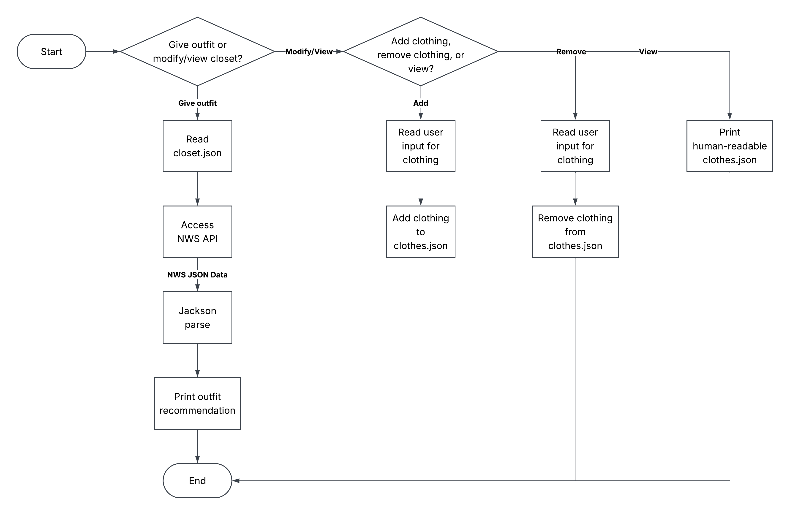

# Fashion Hacker

Suggests an outfit for the day based on weather information and clothes in closet.

## The Problem

I have to spend a few minutes every morning trying to decide what outfit to wear based on the weather.
I wish I could have it automated for me so I can just get it and get out the door.

## How It Works

A paragraph or a few bullets explaining what the software does at a
high level. If you have a diagram, embed it here:



## Tech Stack

- **Language:** Java
- **Libraries:** HTTPClient, Jackson
- **External tools:** National Weather Service API

## Setup

```bash
git clone https://github.com/Chasay1/Fashion-Hacker
cd Fashion-Hacker
```

## Usage

```bash
java main.java
```

From here, follow the instructions from the UI

## Roadmap

Features you haven't built yet but plan to (pull these from your
"Schedule" quadrant in the Eisenhower Matrix).

- [ ] Color matching 
- [ ] Multiple saved locations/default location
- [ ] Outfit history
- [ ] Forecast-based recommendations (for the future)


## Author

Chase Dawson-Kolb ([Github](https://www.github.com/Chasay1))